# ArtBrief AI

게임 아트 에셋 요청(텍스트·이미지)을 받아 **레퍼런스 이미지를 찾아 검토하고, 사용자가 고른 이미지로 아트팀 작업 지시서(`지시서.md`)를 만들어 주는** AI 에이전트 서비스임.

## 1. 프로젝트명 및 주제 선정 배경

- 프로젝트명: **ArtBrief AI**
- 게임 아트 작업은 보통 기획자가 말이나 메신저로 요청 → 아트팀이 부족한 정보를 되묻고 → 레퍼런스를 직접 검색하는 과정을 거침. 이 과정에서 세계관과 맞지 않는 레퍼런스가 모이거나, 회사 규정(색상 수, 폴리곤, 네이밍 등)이 지시에 빠지는 일이 반복됨.
- 이 프로젝트는 **내부 문서(확정된 기획·회사 규정)를 근거로 삼아** 요청을 구조화하고, 레퍼런스 탐색부터 지시서 작성까지를 한 흐름으로 자동화하되 **중요한 결정은 사용자가 확인**하게 하는 것을 목표로 함.

## 2. 해결하고자 하는 문제

| 문제 | 이 프로젝트의 해결 방식 |
|---|---|
| 요청에 정보가 빠져 있음 | 에셋 종류(캐릭터·배경·소품·UI)를 분류하고, 종류별 체크리스트로 부족한 항목을 질문. 답이 없으면 ‘미정’ |
| 세계관에 맞지 않는 레퍼런스 (예: 따뜻한 지역 이미지를 ‘차가운 지방 버전’에 사용) | RAG로 확정된 기획·규정을 검색해 카테고리와 검색어에 반영, 시대 키워드·제외어를 코드로 보장 |
| 검색 결과의 적합성 | 비전 모델이 카테고리별로 점수·이유를 매겨 걸러냄 (탈락 사유도 공개) |
| 이미지 저작권 | 출처별 라이선스를 확인됨/확인 필요/제한됨으로 분류, 확인된 것만 기본 저장 |
| 지시서 근거를 알 수 없음 | 본문에 ‘(레퍼런스_01 참고)’, ‘~규정으로 인해 ~’ 표시와 ‘회사 규정 반영 내역’ 표 제공 |

## 3. 개발 환경 및 기술 스택

| 구분 | 사용 기술 |
|---|---|
| 백엔드 | Python 3.11, FastAPI, Uvicorn, Pydantic v2 |
| 에이전트 | LangGraph (StateGraph, `interrupt`/`Command` 로 사용자 확인 단계 구현, InMemorySaver) |
| LLM | OpenAI — `gpt-4o-mini`(분류·분석·카테고리·이미지 검토), `gpt-4o`(지시서 작성, `WRITER_MODEL` 로 변경 가능), `text-embedding-3-small`(임베딩) |
| RAG | ChromaDB (`vector_db/`), 헤더 기반 청킹 + 메타데이터(`source_type`, `category`) 필터 |
| 이미지 검색 | Openverse, Wikimedia Commons (키 불필요), Tavily (키 필요) |
| 프론트엔드 | Vue 3, Vite, 직접 만든 CSS(Moss Fog 팔레트) |
| 실시간 통신 | SSE (POST + `text/event-stream`, fetch ReadableStream 파싱) |
| 관측 | LangSmith (선택 사항, `wrap_openai` + LangGraph 자동 추적) |
| 테스트 | pytest, vitest + @vue/test-utils + jsdom |
| 배포 | Docker / docker-compose, uv 가상환경 |

## 4. 시스템 아키텍처

### 전체 구성

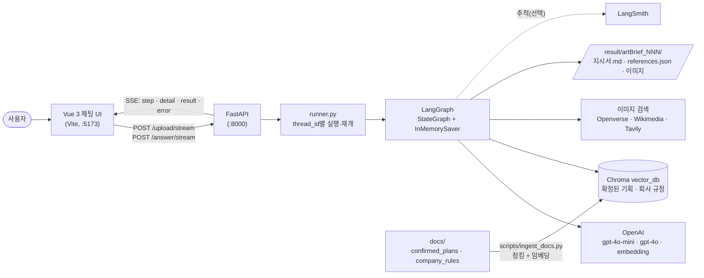

### 에이전트 그래프 (LangGraph)

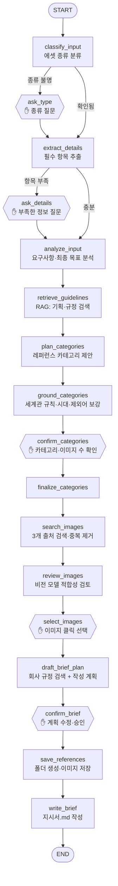

✋ 표시가 있는 육각형 노드는 `interrupt()` 로 멈추고 사용자의 답을 받아 이어서 실행하는 지점임. `ask_*` 노드는 정보가 부족할 때만 실행됨.

### 폴더 구조

```text
back-end/app/      FastAPI 앱, 스키마, agent/ (graph, nodes, brief, storage, review, sources/ …)
back-end/tests/    단위·통합 테스트
frone-end/vue-project/src/   Vue 화면 (views, components, api, styles)
docs/confirmed_plans/        확정된 기획 mock 문서 (세계관·몬스터·배경·의상·소품)
docs/company_rules/          회사 규정 mock 문서 (색상·모델링 최적화·텍스처·네이밍)
scripts/ingest_docs.py       문서를 청킹해 vector_db/ 에 저장
result/                      생성된 결과물 (git 제외)
```

## 5. 주요 구현 기능

1. **입력 이해** — 텍스트+이미지 입력을 받아 에셋 종류를 분류하고, 이미지의 역할(바꿀 원본 / 맥락 자료 / 분위기 참고)을 구분해 ‘최종 목표’를 분석함.
2. **부족한 정보 질문** — 종류별 체크리스트(캐릭터: 성격·나이·의상·표정·무기 등)에서 비어 있는 항목만 질문함.
3. **RAG 기반 카테고리 제안** — 확정된 기획과 회사 규정을 따로 검색해 카테고리·검색어·적용 규칙을 만들고, 시대 키워드와 제외어를 코드로 보장함. 사용자는 카테고리를 수정하고 카테고리별 이미지 수(1~10)를 정함.
4. **이미지 검색과 비전 검토** — 3개 출처에서 후보를 모아 중복을 제거하고, 비전 모델이 카테고리별 적합성을 점수화함. 각 이미지에 사용한 검색어, 점수, 검토 의견, 라이선스를 표시함.
5. **클릭 선택** — 갤러리에서 이미지를 클릭해 고름. 라이선스 미확인 이미지의 파일 저장 여부를 직접 선택함.
6. **지시서 작성 계획 승인** — 쓰기 전에 섹션별 계획을 보여 주고, 사용자가 내용을 수정·추가·삭제·재정렬한 뒤 승인해야 작성함.
7. **결과 저장과 지시서 생성** — `result/artBrief_001/` 처럼 번호 폴더를 만들고 카테고리 폴더에 이미지를 저장한 뒤 `지시서.md` 와 `references.json` 을 만듦.
8. **근거 표시** — 본문에 `(레퍼런스_01 참고)` 와 `~규정으로 인해 ~` 를 표시하고, 이미지별 ‘지시서에서 참고된 곳’과 ‘회사 규정 반영 내역’ 표는 코드가 검증해 작성함.
9. **실시간 진행 표시** — SSE 로 단계와 세부 작업(검색 중인 카테고리 등)을 스트리밍함.

## 6. 프로그램 실행 방법

### 준비

```bash
# 1) 환경변수: 프로젝트 루트에 .env 작성
OPENAI_API_KEY=sk-...
TAVILY_API_KEY=tvly-...            # 선택 (없으면 Openverse·Wikimedia 만 사용)
WRITER_MODEL=gpt-4o                # 선택 (비용을 줄이려면 gpt-4o-mini)
LANGSMITH_TRACING=true             # 선택 (LangSmith 추적)
LANGSMITH_API_KEY=lsv2_...
LANGSMITH_PROJECT=artbrief-ai

# 2) 파이썬 환경 (uv)
uv venv .venv
uv pip install --python .venv/bin/python -r requirements.txt

# 3) 내부 문서를 벡터 DB 에 저장 (최초 1회, 문서를 바꾸면 다시 실행)
.venv/bin/python scripts/ingest_docs.py
```

### 로컬 실행

```bash
# 백엔드 (터미널 1)
cd back-end
../.venv/bin/uvicorn app.main:app --reload --port 8000

# 프론트엔드 (터미널 2)
cd frone-end/vue-project
npm install
npm run dev          # http://localhost:5173
```

### Docker

```bash
docker compose up --build   # 프론트 5173, 백엔드 8000
```

> Docker 실행은 직접 검증하지 못함. 위 로컬 실행을 기준으로 확인함.

### 사용 순서

1. 텍스트와 이미지를 입력 → 2. 부족한 정보 답변 → 3. 카테고리·이미지 수 확인 → 4. 이미지 클릭 선택 → 5. 지시서 작성 계획 확인·수정 → 6. `result/artBrief_NNN/` 확인

## 7. 테스트 결과 및 실행 화면

### 자동 테스트

| 구분 | 명령 | 결과 |
|---|---|---|
| 백엔드 단위·흐름 테스트 | `cd back-end && ../.venv/bin/python -m pytest` | 154 passed |
| 백엔드 통합 테스트 (실제 OpenAI·Chroma·네트워크) | `... pytest -m integration` | 실행 시 API 키 필요 |
| 프론트엔드 | `cd frone-end/vue-project && npm test` | 35 passed (4 파일) |
| 프론트엔드 빌드 | `npm run build` | 성공 |

- 단위 테스트는 OpenAI·검색·이미지 다운로드를 모두 가짜로 대체해, **API 키가 없어도 통과**함.
- 실제 모델로 처음부터 끝까지 돌려 `result/artBrief_NNN/` 이 생성되고 이미지가 저장되는 것을 확인함.
- 브라우저 화면은 컴포넌트 테스트로 클릭·입력 동작을 확인했고, 아래 화면은 직접 실행해 캡처함.

### 실행 화면

<!-- 아래 이미지는 docs/screenshots/ 폴더에 같은 파일 이름으로 저장하면 표시됨. -->

<table>
  <tr>
    <td align="center" width="50%">
      <br>
      <sub>① 첫 화면 — 텍스트 입력과 이미지 첨부</sub>
    </td>
    <td align="center" width="50%">
      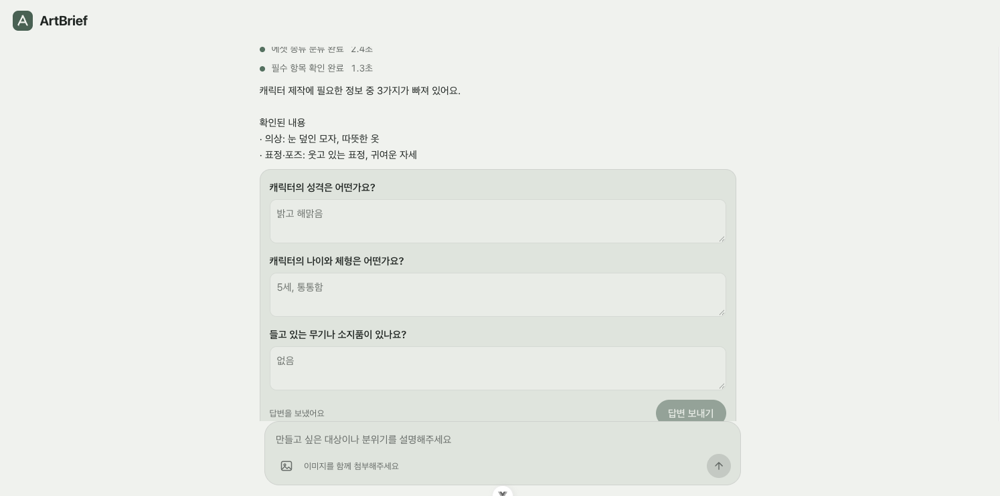<br>
      <sub>② 부족한 정보 질문 — 에셋 종류별 체크리스트 질문 폼(‘모르겠음’ 선택 가능)</sub>
    </td>
  </tr>
  <tr>
    <td align="center" width="50%">
      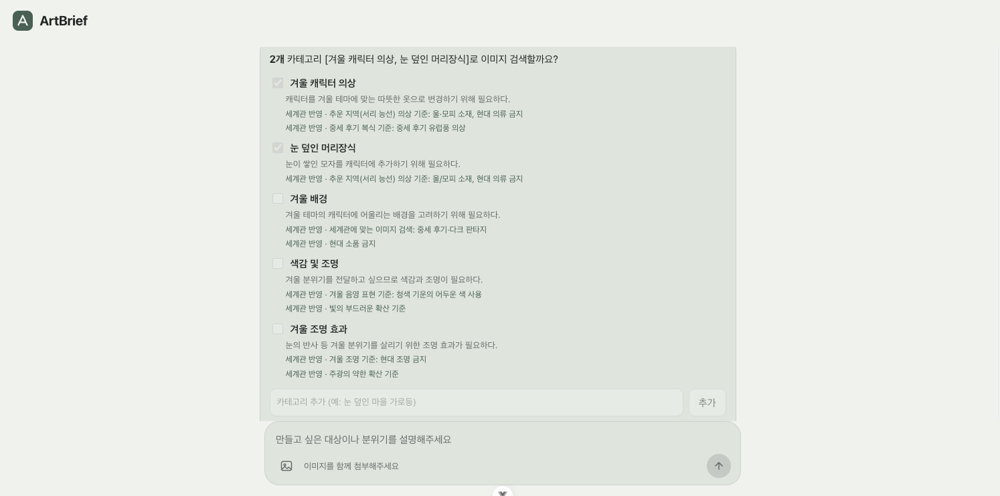<br>
      <sub>③ 레퍼런스 카테고리 제안 — 체크 해제·추가, 카테고리당 이미지 수(1~10) 슬라이더, 제안 이유와 적용된 세계관 규칙</sub>
    </td>
    <td align="center" width="50%">
      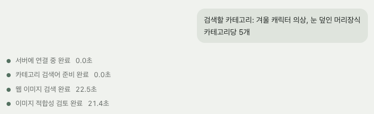<br>
      <sub>④ 진행 상태 스트리밍 — 단계 이름, 경과 시간, 검색 중인 카테고리·검색어 실시간 표시</sub>
    </td>
  </tr>
  <tr>
    <td align="center" width="50%">
      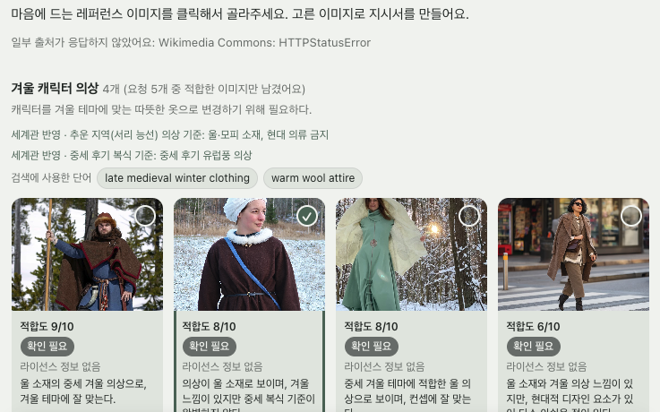<br>
      <sub>⑤ 검토 통과 이미지 갤러리 — 카드 클릭으로 선택, 점수·검토 의견·검색어·라이선스 배지, 하단 선택 바</sub>
    </td>
    <td align="center" width="50%">
      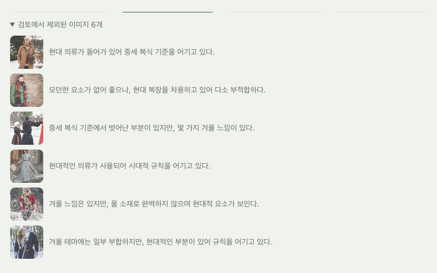<br>
      <sub>⑥ 검토에서 탈락한 이미지 — ‘탈락 이미지 보기’ 펼침과 탈락 이유 (라이선스 미확인 저장 체크박스 포함)</sub>
    </td>
  </tr>
  <tr>
    <td align="center" width="50%">
      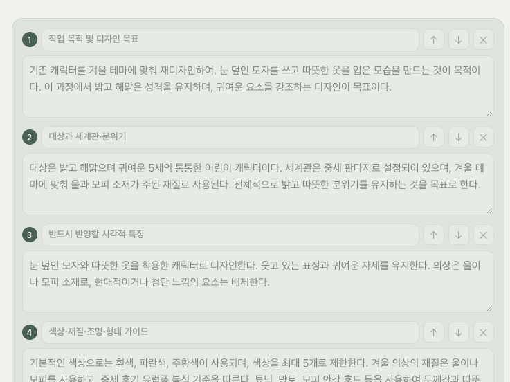<br>
      <sub>⑦ 지시서 작성 계획 확인 — 섹션별 내용 수정·순서 변경·추가·삭제, 추가 요청 입력, 자동 작성 섹션 안내</sub>
    </td>
    <td align="center" width="50%">
      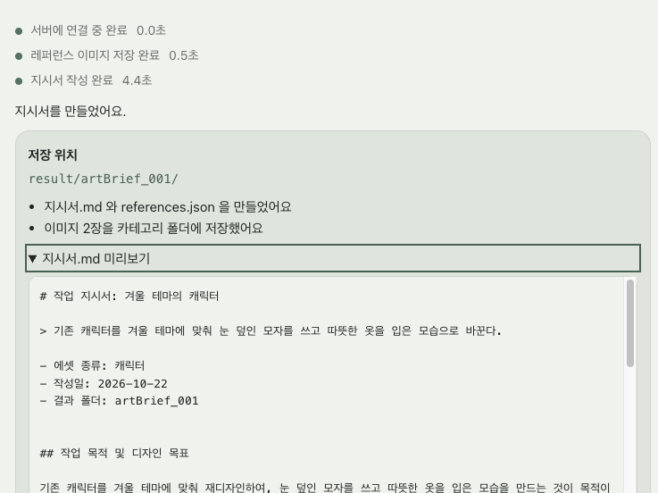<br>
      <sub>⑧ 완료 화면 — 저장 결과 요약(저장·링크만·실패 수)과 지시서 미리보기</sub>
    </td>
  </tr>
  <tr>
    <td align="center" width="50%">
      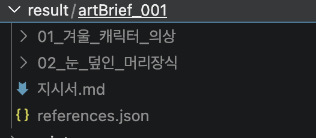<br>
      <sub>⑨ 결과 폴더 구조 — result/artBrief_NNN/ 안의 카테고리 폴더, references.json, 지시서.md (VS Code 탐색기 캡처)</sub>
    </td>
    <td align="center" width="50%">
      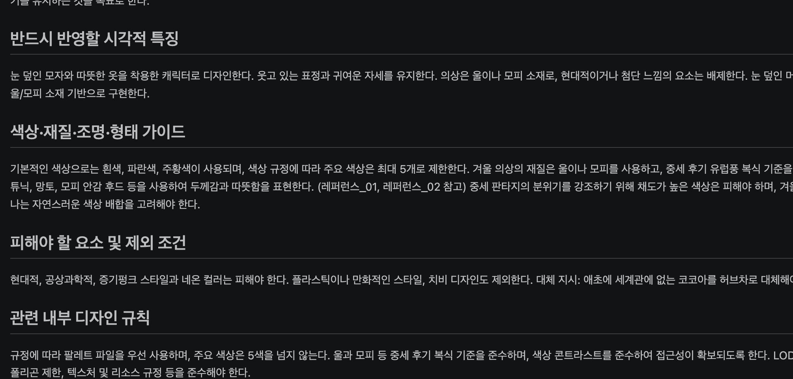<br>
      <sub>⑩ 지시서.md 미리보기 — 본문의 ‘(레퍼런스_01 참고)’ 표시와 ‘~규정으로 인해’ 문장, 참고 이미지가 실제로 보이는 모습</sub>
    </td>
  </tr>
  <tr>
    <td align="center" width="50%">
      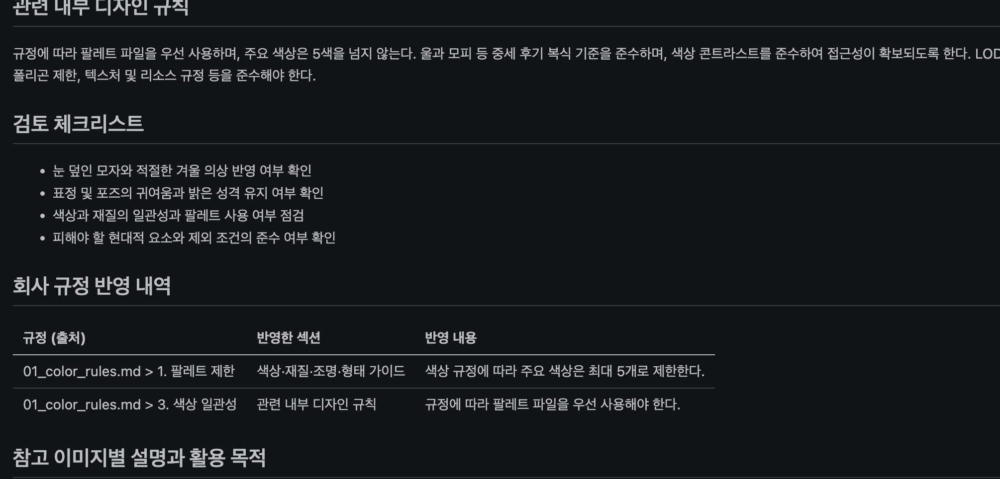<br>
      <sub>⑪ 지시서.md 하단 표 — ‘회사 규정 반영 내역’, ‘참고된 곳’ 표시, 이미지 출처·라이선스 표</sub>
    </td>
    <td align="center" width="50%">
      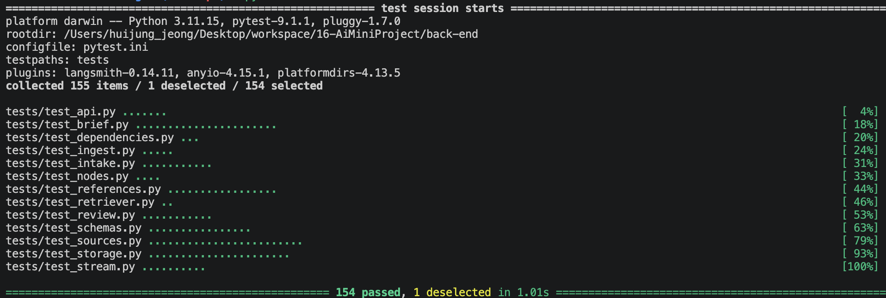<br>
      <sub>⑫ 테스트 실행 결과</sub>
    </td>
  </tr>
</table>

## 8. 개발 과정에서의 문제점 및 해결 방법

| 문제 | 원인 | 해결 |
|---|---|---|
| 차가운 지방 버전을 요청했는데 따뜻한 의상 레퍼런스가 검색됨 | 플래너가 사용자 원문과 최종 목표를 보지 못함 | 원문+`goal` 을 플래너에 전달, 시대·환경 키워드와 제외어를 코드로 보장 (`_ensure_era`, `_drop_conflicting_excludes`) |
| 세계관에 없는 소재(코코아)를 그대로 검색 | 확정 기획이 검색 결과에 안 잡힘 | 기획과 규정을 따로 검색, 짧은 이름 위주 질의로 변경, 대체 지시(허브차 등)가 본문을 우선하도록 규칙화 |
| 빈 답변으로 재개하면 같은 질문이 무한 반복 | LangGraph 가 빈 dict 재개를 ‘답 없음’으로 처리 | 재개 값을 항상 객체로 감싸고 회귀 테스트 추가 |
| 이미지 검토가 지나치게 엄격 | 다른 카테고리 요소까지 감점 | ‘이 카테고리만 판단’하도록 프롬프트 수정, 다운로드 실패 시 썸네일→원본 순 재시도 |
| Wikimedia 이미지 저장 403 | 저장 요청에 User-Agent 없음 | 헤더 추가, 회귀 테스트 |
| 지시서에 틀린 내용(‘3색 제한’, 없는 절차 추가) | 작성 모델이 mini 라서 규정 수치를 왜곡 | 인용 규칙 강화, 작성 모델 기본값을 gpt-4o 로 상향 |
| 단위 테스트가 실제 OpenAI 를 호출 | 일부 검색 함수가 대역에서 빠짐 | 대역 추가, 빈 API 키로 전체 통과 확인 |
| Chroma 동시 접속 시 충돌 | 클라이언트 동시 생성 | 락으로 보호 |
| 지시서 미리보기에서 이미지가 안 보임 | `%` 변환된 한글 경로 | `<경로>` 형식으로 변경 |

## 9. 한계점 및 향후 개선 방향

### 한계점
- 레퍼런스 품질은 실행마다 달라지고, CC 라이선스 사진 출처에는 일러스트·컨셉아트가 적어 일부 카테고리는 통과 이미지가 적음.
- Tavily 결과는 라이선스를 알 수 없어 기본적으로 ‘확인 필요’이며, 파일 저장에는 사용자의 명시적 선택이 필요함.
- 지시서 본문은 AI 초안임. 규정 수치를 인용하게 했지만 사람이 검토해야 함.
- 대화 상태가 서버 메모리(InMemorySaver)에 있어 서버를 재시작하면 진행 중인 작업을 이어갈 수 없음.
- 내부 문서는 mock 데이터이고, 인증·권한·다중 사용자 격리는 구현하지 않음.
- 결과물은 서버의 로컬 폴더에만 저장되며 ZIP 다운로드와 화면에서 폴더 열기는 없음.
- 현업 지시서에 흔한 항목(산출물 규격, 실루엣·형태 언어, 스타일 수위, 2D/3D 기술 사양)은 아직 없음.

### 향후 개선
- 체크포인터를 SQLite/Postgres 로 교체해 재시작 후에도 이어가기
- 지시서 필수 섹션에 산출물·실루엣·스타일 수위 추가, 색상은 ‘역할+개수’, 체크리스트는 측정 가능한 기준으로 작성
- 레퍼런스 설명을 ‘가져올 점 / 가져오지 말 점’ 형식으로 바꾸고 부정 예시 선택 추가
- 계획 단계에서 AI에게 수정 요청을 하는 대화형 보완
- 결과 ZIP 다운로드, 과거 결과 목록 화면
- LangSmith 데이터셋으로 프롬프트 변경 시 품질 비교(평가 자동화)
